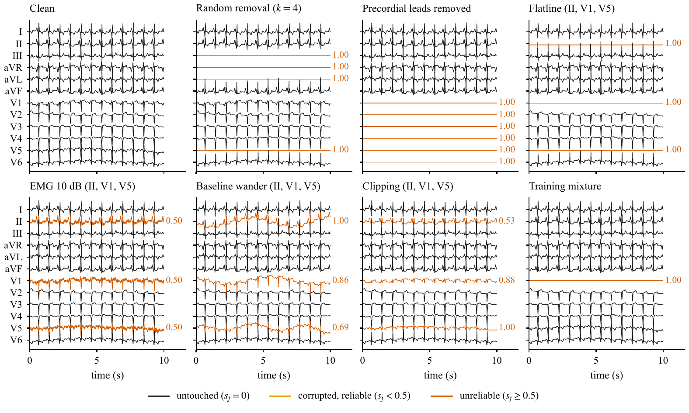
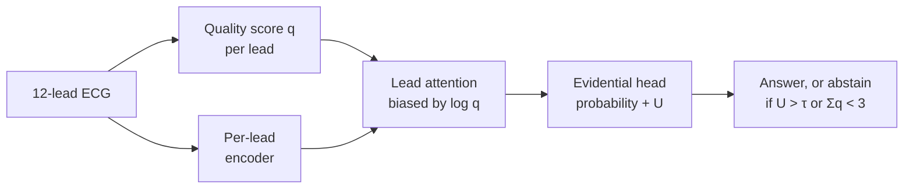
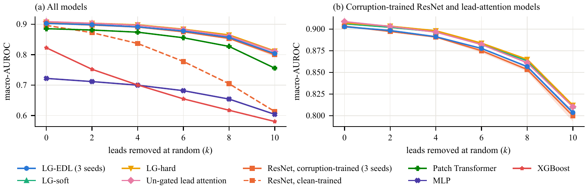
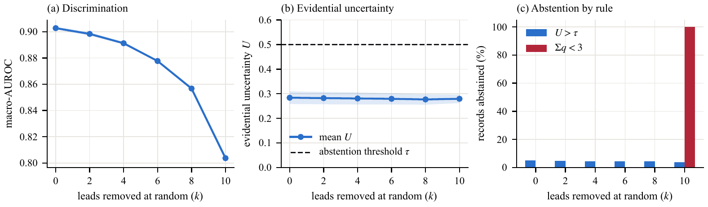
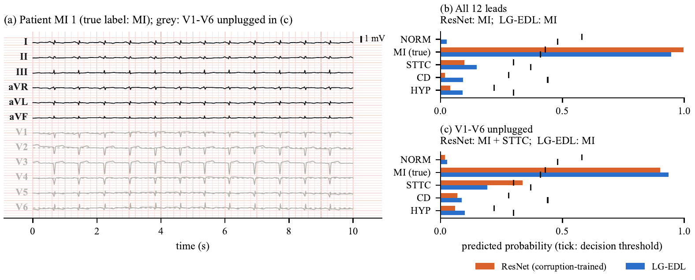

# LeadGuard

**Do quality gating and evidential abstention help ECG classifiers survive lead failure?**
A controlled ablation on PTB-XL, with code, results, paper and an offline demo.

[](https://github.com/Sneakyboss221/leadguard/actions/workflows/ci.yml)
[](LICENSE)


[Paper source](paper/) · [Trained models and PDF (v1.0 release)](https://github.com/Sneakyboss221/leadguard/releases/tag/v1.0) · [Specification](SPEC.md) · [Design decisions](DECISIONS.md)

> Research prototype. Not a medical device and not for clinical use.

---

## The question

A 12-lead ECG classifier is trained on clean, complete recordings. In practice, electrodes fall off and leads
pick up muscle noise, baseline wander or clipping. Several recent architectures handle this with a signal-quality
score per lead, attention over leads, and an uncertainty estimate that lets the model abstain.

This project asks whether those components help **once the baseline is also trained on simulated lead
failures**. Without that baseline, any gain could come from the training data
rather than from the architecture.

## What was tested

The test set (PTB-XL fold 10, 2,158 records, five diagnostic superclasses) is corrupted in 31 fixed conditions:
random removal of 0 to 10 leads, removal of lead groups, and three artifact types. Every model sees exactly the
same corrupted signals.



The full system, **LG-EDL**, works like this:



The quality scorer is a small CNN (47k parameters) trained separately and then frozen. The attention gives each
lead a weight that shrinks with its quality score, and the head outputs, for each of the five classes, a
probability and an uncertainty U. The threshold τ is the 95th percentile of U on clean validation data.

It is compared with three ablations (hard gating, soft gating, attention without gating) and five baselines
(ResNet trained on clean data, the same ResNet trained with simulated failures, a patch Transformer, an MLP and
XGBoost on per-lead features). All neural models share one training budget. LG-EDL and the corruption-trained
ResNet were run with three seeds; the rest with one.

## Results

Macro-AUROC on the PTB-XL test fold, averaged over random draws (and over seeds where there are three):

| Model | All 12 leads | 6 removed | 10 removed |
|---|---:|---:|---:|
| LG-hard (ablation) | 0.907 | 0.884 | **0.812** |
| LG-soft (ablation) | 0.906 | 0.883 | 0.811 |
| Un-gated lead attention (ablation) | **0.909** | 0.882 | 0.810 |
| **LG-EDL** (full system, 3 seeds) | 0.903 | 0.878 | 0.804 |
| ResNet, trained with simulated failures (3 seeds) | 0.903 | 0.875 | 0.800 |
| Patch Transformer | 0.885 | 0.856 | 0.756 |
| ResNet, trained on clean data | 0.896 | 0.778 | 0.613 |
| MLP | 0.722 | 0.682 | 0.604 |
| XGBoost | 0.823 | 0.655 | 0.581 |



**1. Training with simulated failures does most of the work.** The same ResNet goes from 0.613 to 0.800 with
ten of twelve leads missing, with no loss on complete recordings.

**2. Quality gating adds nothing measurable on top of that.** The four attention variants are within 0.008 of
each other at ten missing leads. In paired bootstrap tests, LG-EDL was not significantly better than the
corruption-trained ResNet in any of 28 conditions, and was worse in 4 artifact conditions.

**3. The evidential uncertainty does not notice missing leads.** As leads are removed, discrimination falls from
0.903 to 0.804 while mean uncertainty stays flat (0.284 to 0.279). It also ranks errors no better than the
predicted probabilities. All abstention beyond the clean-data rate comes from the simple rule that counts usable
leads.



### One patient

A test record with myocardial infarction, first complete and then with V1 to V6 unplugged. With the chest leads
missing, the ResNet adds a false ST/T-change label; LG-EDL keeps the correct answer. The demo samples were
chosen so that both models are correct on the complete recording. This is an illustration, not evidence; the
table above is the evidence.



## Running it

Install (Python 3.11, CPU is enough for everything except full PTB-XL training):

```bash
python -m venv .venv
source .venv/bin/activate          # Windows: .venv\Scripts\activate
pip install torch --index-url https://download.pytorch.org/whl/cpu
pip install -r requirements.txt
python -m pytest -q tests.py
```

### Demo

Download `leadguard_checkpoints_v1.zip` from the
[v1.0 release](https://github.com/Sneakyboss221/leadguard/releases/tag/v1.0), unzip it into the repository
folder so the files land in `checkpoints/`, then:

```bash
python app.py
```

The page opens in the browser and works offline. Pick one of 20 test patients, unplug leads or add muscle noise,
and compare LG-EDL with the ResNet baseline side by side, including whether LG-EDL would abstain and why.

### Whole pipeline on synthetic data

Checks that the code runs end to end (about 25 minutes on a laptop CPU). These numbers never go into the paper.

```bash
python pretrain_sqa.py --data synthetic --epochs 40
python run_all.py --data synthetic --debug
python evaluate.py --data synthetic --debug --strict
python figures.py
```

### Full reproduction on PTB-XL

Download [PTB-XL v1.0.3](https://physionet.org/content/ptb-xl/1.0.3/) from PhysioNet (about 2 GB). The paper's
13 training runs took about 25 minutes on one GPU.

```bash
python data.py --name ptbxl --root PATH/TO/ptb-xl-1.0.3
python pretrain_sqa.py --data ptbxl --ckpt-dir OUT/checkpoints --out-dir OUT/results
python run_all.py --data ptbxl --ckpt-dir OUT/checkpoints --out-dir OUT/results
python evaluate.py --data ptbxl --strict --ckpt-dir OUT/checkpoints --out-dir OUT/results
```

`pretrain_sqa.py` must end with `PASS`. `run_all.py` resumes interrupted runs, so the same command continues
after a disconnect.

### Paper

Every number in the paper is generated from `results/*.csv`:

```bash
python paper/make_numbers.py      # numbers, tables and figures
python paper/make_vignette.py     # the single-patient figure (needs the checkpoints)
```

Then compile `paper/main.tex` with pdflatex and bibtex, or upload `paper/` to Overleaf.

## Limitations

- Lead failures are simulated, and the test failures are of the same types as those seen in training. Real
  artifacts and unseen failure types were not tested.
- One dataset. The ablations were run with a single seed.
- The design is not factorial: only the ResNet was trained both with and without simulated failures.
- Retrospective evaluation only.

## Repository layout

| Path | Contents |
|---|---|
| `data.py`, `corrupt.py` | PTB-XL and synthetic loaders; the lead-failure simulation |
| `quality.py`, `pretrain_sqa.py` | Signal-quality assessor and its pre-training |
| `models.py`, `baseline_xgb.py` | LG-EDL, ablations and baselines |
| `train.py`, `run_all.py`, `evaluate.py` | Training (resumable), the run list, all test conditions and metrics |
| `results/` | Every metric reported in the paper, as CSV |
| `paper/` | LaTeX source, bibliography and the scripts that generate its numbers and figures |
| `app.py`, `demo/`, `demo_samples/` | Offline demo: local server, single-page UI, 20 test records |
| `tests.py` | Invariant and sanity tests, run by CI on every push |
| `SPEC.md`, `DECISIONS.md` | The study specification and every deviation from it |

## Data and license

PTB-XL v1.0.3: Wagner et al., *Scientific Data* 7, 154 (2020),
[doi:10.1038/s41597-020-0495-6](https://doi.org/10.1038/s41597-020-0495-6); PhysioNet,
[doi:10.13026/kfzx-aw45](https://doi.org/10.13026/kfzx-aw45). The raw data are not included here.
`demo_samples/` holds 20 test-fold records derived from PTB-XL.

Code is under the MIT license. To cite this repository, use [`CITATION.cff`](CITATION.cff).

Sanjit Patibanda, Vellore Institute of Technology, Chennai.
